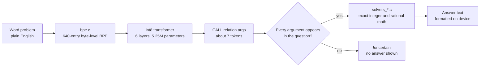
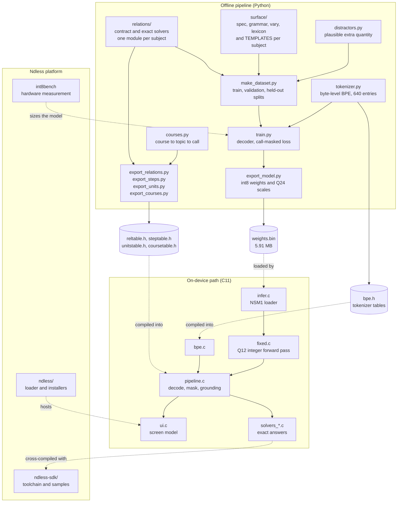

# NdlessAI

NdlessAI is an on-device STEM solver for TI-Nspire calculators, built as a fork of [Ndless](https://github.com/ndless-nspire/Ndless). A small int8 transformer reads a word problem and emits one exact solver call; the calculator computes the answer in integer and rational arithmetic. There is no network, no floating point in the hot path, and the model never writes the answer itself.

> **Status: developer research preview.** The data contract, training and export pipeline, C inference engine, and ARM cross-compile checks are implemented and exercised on the host. The app builds as `stemhelp.tns`, but it has never been run on a physical calculator, and no trained checkpoint or release artifact is committed.

## How it works

The model maps language to a fixed-arity call, not to an answer:

```text
Solve x^2 - 5x + 6 = 0  ->  CALL quad_solve 1 -5 6  ->  x=2, x=3
```



The grounding check is deliberately conservative. If the model copies a number that is not present in the question, the runtime refuses the answer instead of showing a plausible wrong one. The relation name and `CALL` are single tokens, and the exported tokenizer uses a 640-entry vocabulary.

## At a glance

| | |
| --- | --- |
| Task | English word problem to one `CALL <relation> <args>` line |
| Model | 5,246,208 parameters; 6 layers, d=256, 8 heads, hidden 768, vocabulary 640 (208 merges) |
| Training | Llama-2-style decoder with RoPE and a loss masked to call tokens |
| Runtime | C11; int8 weights, Q12 fixed-point activations, no FPU in the hot path |
| Target | TI-Nspire CX II, ARM926EJ-S; hardware cost measured with `int8bench` |
| Artifacts | `weights.bin` (5.91 MB, NSM1 format) and an embedded BPE header |
| Subjects | Precalculus, calculus, trig, logs, algebra, physics, chemistry, and units |
| Status | Research preview; host-verified and builds a `.tns` for the calculator |

## Supported relations

Every relation has a fixed arity, an exact solver, and wording to read. `surface/`
holds phrasings for all 171 relations, at least eight each, and reserves every
fifth index of each list for held-out wording. 163 of the relations also carry
hand-written paraphrase rows in `fixtures/` (4,768 rows across fifteen files).
A row's train or eval half is a field in the file it lives in — 0 of the 4,768
questions appears in both halves — so rebuilding the corpus cannot move one.

The tags below are the ten in `runtime/reltable.h`, so the counts sum to the
catalogue total; `docs/status.md` splits physics into its electricity, magnetism
and thermodynamics groups for display, which is why its table has more rows.

| Subject | Count | Relations |
| --- | --- | --- |
| Physics | 56 | `adiabatic_work`, `beat_freq`, `bernoulli_pressure`, `buoyant_force`, `capacitor_charge`, `capacitor_energy`, `carnot_efficiency`, `circular_accel`, `collision_velocity`, `conduction_rate`, `continuity_velocity`, `coulomb_force`, `doppler_freq`, `double_slit_fringe`, `electric_field_point`, `energy_friction`, `entropy_change`, `free_fall`, `friction_force`, `gas_density`, `gas_heat_cp`, `gas_work_isobaric`, `gauge_pressure`, `heat_pump_cop`, `impulse`, `internal_energy_gas`, `kinematic_v`, `kinetic_energy`, `momentum`, `motional_emf`, `newton2`, `ohm_i`, `ohm_power`, `ohm_v`, `parallel_resistance`, `pascal_press`, `pendulum_period`, `potential_energy`, `power`, `power_force`, `proj_range`, `radiation_power`, `rms_speed`, `series_resistance`, `sound_intensity`, `sound_level`, `specific_heat`, `spring_energy`, `standing_wave_freq`, `string_freq`, `submerged_fraction`, `torque`, `volume_flow_rate`, `wave_speed`, `work`, `work_energy` |
| Chemistry | 48 | `atoms_from_mass`, `avg_rate`, `beer_lambert`, `boyles`, `buffer_ph`, `calorimetry_c`, `calorimetry_mass`, `carnot`, `cell_potential`, `charles`, `combined_gas`, `density`, `dilution`, `dilution_v1`, `faraday_deposit`, `first_law`, `gas_mixture_pressure`, `gas_p`, `gibbs`, `h_from_ph`, `heat_reaction`, `hydrate_water`, `kc_from_conc`, `ksp_from_solubility`, `latent_heat`, `limiting_moles`, `mass_from_molarity`, `mass_from_percent_composition`, `mass_percent`, `mixing_concentration`, `mixture_final_temperature`, `molality`, `molarity`, `mole_fraction`, `moles`, `partial_pressure`, `percent_dissociation`, `percent_yield`, `ph`, `ph_from_poh`, `ph_of_water`, `poh`, `rate_factor`, `stoich_mass`, `stoich_volume_gas`, `stoichiometry`, `vsepr_bond_angle`, `wavelength_from_frequency` |
| Units | 20 | `average`, `average_speed`, `celsius_to_fahrenheit`, `combined_rate`, `fahrenheit_to_celsius`, `kg_to_lb`, `km_to_m`, `liters_to_ml`, `m_to_cm`, `percent_change`, `percent_error`, `percent_of`, `probability_single`, `ratio_share`, `rectangle_area`, `scientific_notation`, `sig_figs`, `simple_interest`, `triangle_area`, `volume_prism` |
| Modern physics | 9 | `activity_bq`, `bohr_energy_ev`, `bohr_transition_nm`, `de_broglie_electron`, `half_life_fraction`, `mass_energy_mev`, `photoelectric_kev`, `photon_energy_ev`, `threshold_wavelength` |
| Trig | 9 | `arc_length`, `cos_eval`, `law_cosines`, `law_sines`, `pythagoras`, `right_triangle`, `sin_eval`, `sinusoid`, `tan_eval` |
| Algebra | 7 | `abs_value_eq`, `arith_seq`, `complete_square`, `cubic_solve`, `factor_quadratic`, `geom_seq`, `linear_ineq` |
| Logs | 7 | `compound_interest`, `continuous_growth`, `doubling_time`, `half_life`, `ln_eval`, `log10_eval`, `log_eval` |
| Precalculus | 7 | `average_rate_of_change`, `exp_solve`, `linear2`, `quad_solve`, `vector_add`, `vector_dot`, `vector_scale` |
| Optics | 6 | `critical_angle`, `index_from_speed`, `lens_image_distance`, `lens_magnification`, `mirror_image_distance`, `snell_angle` |
| Calculus | 2 | `deriv_poly3`, `integr_poly3` |

## Quickstart

Requirements are Python 3, [`uv`](https://docs.astral.sh/uv/), `make`, and a C11 compiler. A GPU is optional; the recorded training run used two CPU cores.

```sh
cd stem-model

make data         # about 200k traces plus the tokenizer (roughly 11 minutes)
make train        # 5.25M-parameter decoder; 834 s on 2 CPU cores in the recorded run
make export       # weights.bin and the generated tokenizer header
make host         # build the C engine and its test binaries
make eval         # score the int8 engine on held-out validation rows
make eval-device  # score the full path: BPE, fixed point, call, C solver
make test         # the full Python suite
```

No weights are committed. The commands above create `stem-model/data/`, `stem-model/model.pt`, and `stem-model/weights.bin` locally. See [docs/development.md](docs/development.md) for the complete workflow and for adding a relation.

## Repository map



| Path | Contents |
| --- | --- |
| [`stem-model/`](stem-model/) | Python data, training, export, evaluation, and the C runtime |
| [`stem-model/relations/`](stem-model/relations/) | The call contract in `core.py`, and one module per subject holding that subject's relations and solvers |
| [`stem-model/surface/`](stem-model/surface/) | Slot specs, the clause grammar, wording families, the lexicon, and one `TEMPLATES` table per subject |
| [`stem-model/runtime/`](stem-model/runtime/) | BPE, fixed-point transformer, NSM1 loader, the pipeline, the solvers, the screen, and the host and device entry points |
| [`stem-model/device/`](stem-model/device/) | The Ndless app: key mapping, the keypad and panel, and the Makefile that packages `stemhelp.tns` |
| [`stem-model/tests/`](stem-model/tests/) | The measurement instruments: the split, the floors, the answer formats, the spec, and the pipeline |
| [`ndless-sdk/samples/int8bench/`](ndless-sdk/samples/int8bench/) | Hardware benchmark that settled the int8 dot-product cost on a CX II |
| [`ndless/`](ndless/) and [`ndless-sdk/`](ndless-sdk/) | Upstream Ndless loader, installers, toolchain, and samples |
| [`docs/`](docs/) | Architecture, model notes, development guide, and upstream Ndless documentation |

## Documentation

- [Status](docs/status.md): where the project stands, what is planned, and what is left.
- [Expansion](docs/expansion.md): every candidate addition, ranked by value per unit of work.
- [Waves](docs/waves.md): the execution plan of record — wave order, workstreams, file ownership, and what done means.
- [Closed lines](docs/closed-lines.md): the four wording and selection ideas that were measured and closed, with the sets and the ratio a replacement has to beat.
- [Wave 2 design](docs/wave2-design.md): the shapes behind the equation engine and symbolic differentiation, written before implementation.
- [Architecture](docs/architecture.md): boundaries, call contract, fixed-point formats, and failure behavior.
- [Model](docs/model.md): data generation, training, quantization, measured results, and limitations.
- [Development](docs/development.md): host workflow, tests, cross-compilation, and adding a relation.
- [Upstream Ndless](docs/upstream-ndless.md): the original Ndless README and calculator installation instructions.

## Ndless and licensing

NdlessAI leaves the upstream Ndless loader, installers, and SDK in place; the only addition under `ndless-sdk/` is the `int8bench` sample. Installing Ndless on a calculator works exactly as it does upstream; see [docs/upstream-ndless.md](docs/upstream-ndless.md) or the [Ndless user guide](https://tiplanet.org/ndless). `make -C stem-model/device` builds `stemhelp.tns` and packages the weights as `weights.bin.tns`; both are build outputs and are not committed.

This repository is a derivative of Ndless and retains its licensing: most work is covered by the Mozilla Public License 1.1, and components with their own `LICENSE.txt` or `LICENSE.html` keep those terms. Read [`Mozilla-Public-License-v1.1.html`](Mozilla-Public-License-v1.1.html) before redistributing any part of the repository. Upstream links: [website](http://ndless.me), [source](https://github.com/ndless-nspire/Ndless), [wiki](https://hackspire.org), [developer guide](https://ndlessly.wordpress.com/ndless-for-developers/).
