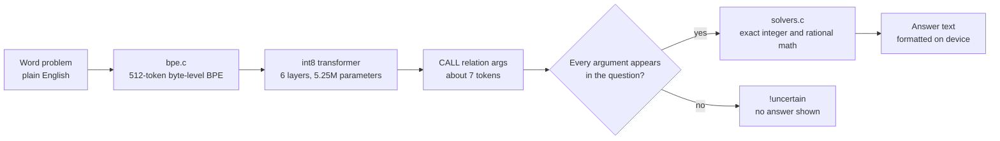
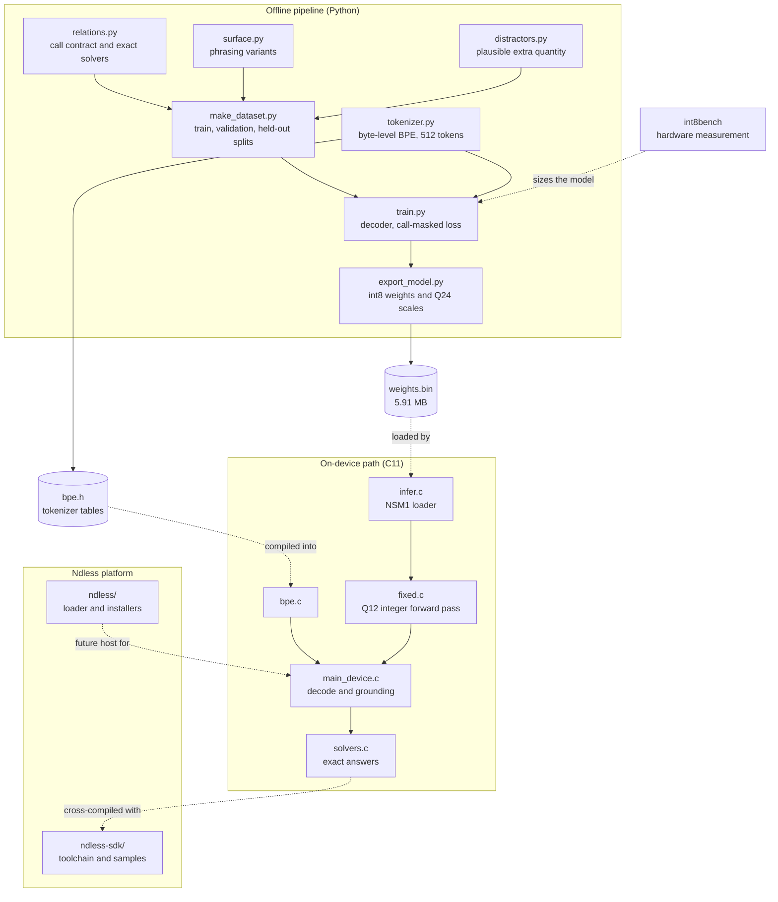

# NdlessAI

NdlessAI is an on-device STEM solver for TI-Nspire calculators, built as a fork of [Ndless](https://github.com/ndless-nspire/Ndless). A small int8 transformer reads a word problem and emits one exact solver call; the calculator computes the answer in integer and rational arithmetic. There is no network, no floating point in the hot path, and the model never writes the answer itself.

> **Status: developer research preview.** The data contract, training and export pipeline, C inference engine, and ARM cross-compile checks are implemented and exercised on the host. The runtime is not yet packaged as a `.tns` application, and no trained checkpoint or release artifact is committed.

## How it works

The model maps language to a fixed-arity call, not to an answer:

```text
Solve x^2 - 5x + 6 = 0  ->  CALL quad_solve 1 -5 6  ->  x=2, x=3
```



The grounding check is deliberately conservative. If the model copies a number that is not present in the question, the runtime refuses the answer instead of showing a plausible wrong one. The relation name and `CALL` are single tokens, and the exported tokenizer uses a 512-token vocabulary.

## At a glance

| | |
| --- | --- |
| Task | English word problem to one `CALL <relation> <args>` line |
| Model | 5,246,208 parameters; 6 layers, d=256, 8 heads, hidden 768, vocabulary 512 |
| Training | Llama-2-style decoder with RoPE and a loss masked to call tokens |
| Runtime | C11; int8 weights, Q12 fixed-point activations, no FPU in the hot path |
| Target | TI-Nspire CX II, ARM926EJ-S; hardware cost measured with `int8bench` |
| Artifacts | `weights.bin` (5.91 MB, NSM1 format) and an embedded BPE header |
| Subjects | Precalculus, calculus, physics, and chemistry |
| Status | Research preview; host-verified, not yet a calculator application |

## Supported relations

Every relation has a fixed arity, a generator, an exact solver, and at least eight phrasings. Every fifth phrasing is reserved for held-out wording tests.

| Subject | Relations |
| --- | --- |
| Precalculus | `quad_solve`, `linear2`, `exp_solve` |
| Calculus | `deriv_poly3`, `integr_poly3` |
| Physics | `kinematic_v`, `proj_range`, `ohm_i` |
| Chemistry | `moles`, `dilution`, `gas_p` |

## Quickstart

Requirements are Python 3, [`uv`](https://docs.astral.sh/uv/), `make`, and a C11 compiler. A GPU is optional; the recorded training run used two CPU cores.

```sh
cd stem-model

make data         # about 200k traces plus the tokenizer (roughly 11 minutes)
make train        # 5.25M-parameter decoder; 834 s on 2 CPU cores in the recorded run
make export       # weights.bin and the generated tokenizer header
make host         # build the C engine and its test binaries
make eval         # score the int8 engine on held-out validation rows
make eval-device  # score the full path: BPE, fixed point, call, C solver
make test         # the full Python suite
```

No weights are committed. The commands above create `stem-model/data/`, `stem-model/model.pt`, and `stem-model/weights.bin` locally. See [docs/development.md](docs/development.md) for the complete workflow and for adding a relation.

## Repository map



| Path | Contents |
| --- | --- |
| [`stem-model/`](stem-model/) | Python data, training, export, evaluation, and the C runtime |
| [`stem-model/runtime/`](stem-model/runtime/) | BPE, fixed-point transformer, NSM1 loader, solvers, host and device entry points |
| [`stem-model/tests/`](stem-model/tests/) | Golden solver values, data invariants, quantization, tokenizer, packing, training, and logit parity |
| [`ndless-sdk/samples/int8bench/`](ndless-sdk/samples/int8bench/) | Hardware benchmark that settled the int8 dot-product cost on a CX II |
| [`ndless/`](ndless/) and [`ndless-sdk/`](ndless-sdk/) | Upstream Ndless loader, installers, toolchain, and samples |
| [`docs/`](docs/) | Architecture, model notes, development guide, and upstream Ndless documentation |

## Documentation

- [Architecture](docs/architecture.md): boundaries, call contract, fixed-point formats, and failure behavior.
- [Model](docs/model.md): data generation, training, quantization, measured results, and limitations.
- [Development](docs/development.md): host workflow, tests, cross-compilation, and adding a relation.
- [Upstream Ndless](docs/upstream-ndless.md): the original Ndless README and calculator installation instructions.

## Ndless and licensing

NdlessAI leaves the upstream Ndless loader, installers, and SDK in place; the only addition under `ndless-sdk/` is the `int8bench` sample. Installing Ndless on a calculator works exactly as it does upstream; see [docs/upstream-ndless.md](docs/upstream-ndless.md) or the [Ndless user guide](https://tiplanet.org/ndless). NdlessAI does not yet ship a `.tns` build of the solver.

This repository is a derivative of Ndless and retains its licensing: most work is covered by the Mozilla Public License 1.1, and components with their own `LICENSE.txt` or `LICENSE.html` keep those terms. Read [`Mozilla-Public-License-v1.1.html`](Mozilla-Public-License-v1.1.html) before redistributing any part of the repository. Upstream links: [website](http://ndless.me), [source](https://github.com/ndless-nspire/Ndless), [wiki](https://hackspire.org), [developer guide](https://ndlessly.wordpress.com/ndless-for-developers/).
