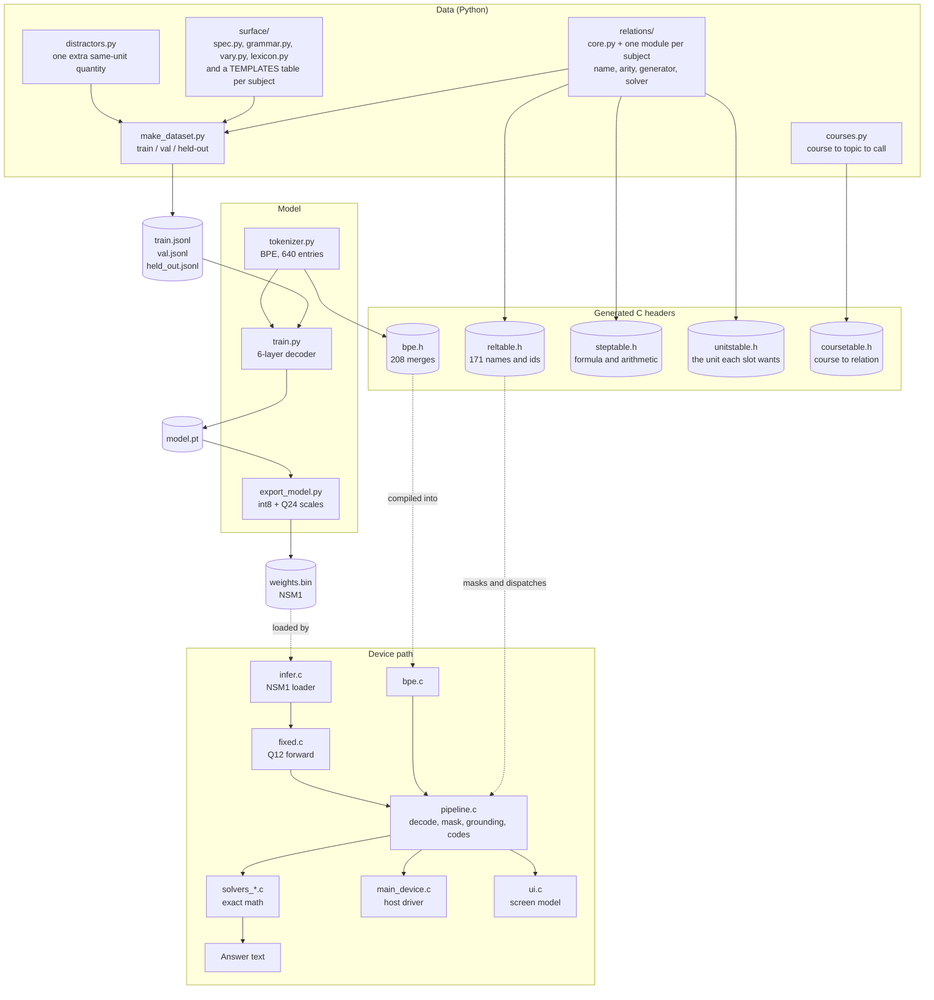
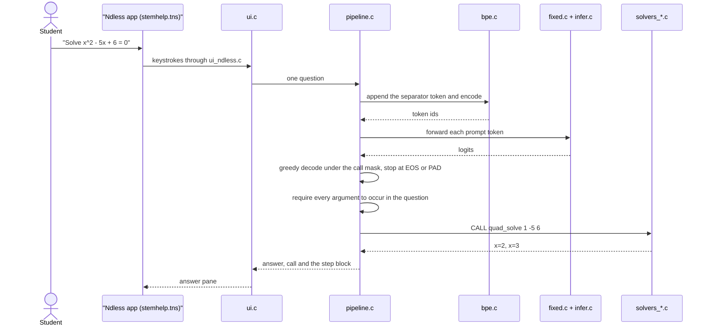

# Architecture

NdlessAI has two halves. An offline Python pipeline turns relation definitions into a dataset, a tokenizer, a trained checkpoint, and quantized weights, and generates five C headers from the same definitions so the runtime never keeps a hand-written copy of a table. An on-device C11 runtime turns a question into a call, executes that call with exact arithmetic, and formats the answer. Ndless supplies the calculator platform around the runtime.

## Design constraints

- **No FPU on the target.** A CX II uses an ARM926EJ-S without floating-point hardware. A stray float in the decode loop costs thousands of cycles, so the hot path is integer-only and the cross-compile check fails on soft-float helpers.
- **Every token rereads the weights.** Sequential RAM reads measured about 70.5 MB/s, and the largest single allocation is about 21.56 MiB. Token count, not kernel cleverness, is the main speed lever.
- **Answers must be exact.** The model selects a relation and fills numeric slots. The `solvers_*.c` units do the mathematics in integers and rationals, so the model never decides a final value.
- **Wrong answers are worse than no answer.** Every call argument must appear in the question, a call whose relation the decode barely chose is refused, and arithmetic the exact engine cannot hold or has no value for is refused by name rather than printed. Four result codes make those refusals distinguishable to the screen.
- **The clock is disputed.** Reported values range from 144 MHz to 396 MHz. The `int8bench` sample measures the actual unit before a model size is fixed.

## Data and artifact flow



## Boundaries

| Component | Responsibility |
| --- | --- |
| `relations/core.py` | The contract. A relation owns its name, subject, parameter names, generator, solver, and whether it is exact. Fixed arity keeps the output grammar trivial. |
| `relations/*.py` | One module per subject — algebra, calculus, chemistry, em, fluids, logs, modern, optics, physics, precalc, thermo, trig, units, waves — each registering its relations into the catalogue the rest of the pipeline reads. |
| `surface/spec.py` | What a relation's slots are in the vocabulary a student uses: role, unit, dimension, and the wordings written for it. A parameter name is not a role. |
| `surface/grammar.py` | Composes a sentence from independent clause families and refuses a structure a reader could not resolve. |
| `surface/vary.py` | Wording families that rewrite a rendered question so its surface is not fixed to the templates. |
| `surface/lexicon.py` | The words a student writes for a quantity, keyed by dimension and register. |
| `TEMPLATES` in `surface/` | The fixed phrasings: all 171 relations, at least eight each, with every fifth index of each list reserved for held-out wording (`surface.is_held_out`). `tests/test_pipeline.py` asserts the coverage and that no train index is a held-out one. |
| `distractors.py` | Adds one plausible same-unit quantity to a question without changing the correct call. The share is a dataset flag, `--distractors 0.5`, its default, in the recorded recipe. |
| `make_dataset.py` | Builds train, validation, held-out and wording-eval splits, and trains the tokenizer on a sample. Split seeds are disjoint, and `injected_rows()` fills the hand-written share of train exactly rather than rounding it down. A hand-written row's half is a field in its own fixture file, so a corpus rebuild cannot move a row between the halves. |
| `tokenizer.py` | Byte-level BPE over 640 entries: ids 0–255 are bytes, 256 `<pad>`, 257 `<bos>`, 258 `<eos>`, 259 `CALL`, 260 `<sep>`, 261–431 the 171 relation names, and the 208 merges start at 432. |
| `train.py` | Llama-2-style decoder with RoPE, RMSNorm, SwiGLU, and tied embeddings. The loss is masked to call tokens, and a training window never straddles two rows. |
| `export_model.py` / `export_int8.py` | Per-output-channel int8 quantization with group size 32 and Q24 fixed-point scales. Emits `NSM1` weights and a reference logit fixture. |
| `export_tokenizer.py` | Regenerates the BPE tables inside `runtime/bpe.h` from the exact tokenizer the checkpoint was trained with. |
| `export_relations.py`, `export_steps.py`, `export_units.py`, `export_courses.py` | Generate `reltable.h`, `steptable.h`, `unitstable.h` and `coursetable.h` from the Python definitions. Each has a `--check` mode, and `gate.sh` fails on a stale one. |
| `gen_wording.py` | Generates the clause-composed wording corpus and the ledger that counts structures rather than rows. `--check` fails on a stale ledger, `--cohort` scores the drift set. |
| `evaluate.py`, `evaluate_device.py`, `evaluate_paraphrase.py`, `report_relations.py` | Score the generated held-out set, the whole device path, the hand-written paraphrase bank and the per-course floors. The last refuses to score a set a floor was not calibrated on unless `--allow-drift` is passed. |
| `runtime/infer.c` | Loads and validates `NSM1`, and provides a float reference forward pass used for parity checks. |
| `runtime/fixed.c` | The device forward pass: int8 dot products, Q12 activations, table-based exp and reciprocal, integer softmax, and Q14 RoPE. |
| `runtime/bpe.c` | Byte-level BPE encode and decode with the embedded tables. |
| `runtime/pipeline.c` | The decision path: prompt suffix, encode, greedy decode under the call mask, the relation margin, grounding, digit repair, and the result code the screen shows. |
| `runtime/callmask.c` | The mask over the call header: `CALL`, then the separator, then one relation name from `reltable.h`, then a blacklist that stops the model restarting the header or swapping in a second relation. It deliberately does not limit the argument count or decide when a number ends, because a number's end is not a token boundary the runtime can see. |
| `runtime/grounding.c` | One span scan over the question, shared by the guard and the repair pass, so the two cannot disagree about where a number is. |
| `runtime/repair.c` | A single unambiguous digit edit on a value the guard could not place. |
| `runtime/plan.c`, `runtime/shorthand.c` | Typed input that bypasses the model: a plan of calls, and a relation named by its initials or by its full name. |
| `runtime/expr.c`, `runtime/equation.c`, `runtime/matrix.c` | The typed maths path: Q16 expression parser, evaluator, symbolic differentiation and integration, equation solving, and exact rational linear algebra. |
| `runtime/solvers.c` + eleven `solvers_*.c` units | Dispatch, then exact integer and rational arithmetic per subject, plus decimal formatting for non-exact answers. |
| `runtime/graph.c`, `diagram.c`, `screen.c`, `ui.c` | The display: the plot of a call's own relation, the subject diagrams, the framebuffer primitives, and the screen model that replaced the message boxes. |
| `runtime/main_device.c` | The host driver: one question per line in, one tab-separated result out. It is what every Python evaluator invokes. |
| `runtime/main_host.c` | A host-only build of the generation path (`make infer_host`). Nothing in the Python evaluators calls it today — they drive `main_device`. |
| `runtime/test_*.c` | 22 host test binaries, driven by `gate.sh` and runnable one at a time. |
| `device/main.c`, `device/ui_ndless.c` | The Ndless app: 61 lines of key mapping, and the keypad and panel that feed the same `ui.c` screen model. |
| `gate.sh` | One entry point for every check that does not need a calculator. |
| `ndless-sdk/samples/int8bench/` | Measures int8 dot-product cost and the real clock on the calculator. It is not part of the solver. |

## The call contract

A call is one line with a fixed number of whitespace-separated fields:

```text
CALL <relation> <arg> <arg> ...
```

Examples:

```text
CALL quad_solve 1 -5 6
CALL integr_poly3 1 -3 2 0 0 4
CALL gas_p 0.5 298 1
```

The runtime enforces the contract in four places:

1. `pipeline.c` decodes at most 20 tokens (`MAX_GEN`) and stops at `<eos>` or `<pad>`.
2. `callmask.c` makes the malformed header impossible rather than merely rejected: the first token can only be `CALL`, the second only `<sep>`, the third only a relation name from `reltable.h`, and after that `CALL` and the relation names are removed so the call cannot be restarted.
3. `pipeline_args_grounded` requires every argument string, from the third field onward, to occur in the original question. This catches the model's dominant failure: copying a plausible digit that belongs to a distractor or to the wrong slot. `repair.c` gets one unambiguous edit before the guard refuses.
4. `solvers_solve` dispatches by relation and rejects an unknown relation, a wrong argument count, a malformed number, complex roots, or a singular system.

The solver is the only component that produces an answer. The model produces a call, and a call that fails validation produces no answer. `pipeline.h` carries the verdicts: `PIPELINE_OK`, `PIPELINE_UNCERTAIN`, `PIPELINE_TOO_LONG`, `PIPELINE_NO_VALUE` and `PIPELINE_ERR`.

## A question on the device path



`main_device.c` is a host-runnable program over the same `pipeline.c`, and `device/` wraps that pipeline in a Ndless app: `device/main.c` maps keys into the screen model in `runtime/ui.c`, and `device/ui_ndless.c` draws the panel and reads the keypad. `make -C device` builds `stemhelp.tns` and packages `weights.bin` beside it. The app is cross-compiled for `arm926ej-s` and checked with `runtime/crosscheck.sh`, but it has not been started on a calculator.

## Quantization and fixed point

The export format is deliberately small and loadable without a framework:

```text
NSM1
dim, layers, heads, hidden, vocab            five int32 values
tok_emb                                      int8 matrix + int32 scales
wq, wk, wv, wo, w1, w3, w2                   stacked per layer, int8 + scales
n1, n2, norm                                 float parameters
```

Every quantized matrix uses groups of 32 columns. Each group has one Q24 scale, which kept the maximum per-group reconstruction error at `4.2e-4` in the recorded export. Q16 was rejected because its weight error was too large.

| Value | Format |
| --- | --- |
| Activations, logits, attention scores | `int16` or `int32`, Q12 |
| Softmax weights | Q15, summing to about 32768 |
| RoPE cosine and sine | Q14 |
| RMSNorm gains | Q12 |
| Weight group scales | Q24 as stored, converted at init |

`qstate_init` may use libm because it builds the exp, SiLU, rsqrt, reciprocal, and RoPE tables. After that, `forward_q` uses integer arithmetic only. `crosscheck.sh` compiles every runtime unit for ARM and inspects the object files for `__aeabi_f*` or `__aeabi_d*` references, exempting exactly two functions by name: `qstate_init`, which builds the tables once at startup, and `solve_exp`, whose fallback renders four significant digits after the integer path has already failed and which is marked `noinline` so it cannot be folded into its caller.

## Failure behavior

The pipeline returns one of five codes. The host driver prints the last four as a tab-separated verdict followed by the call it produced; the screen turns them into four sentences, and a weights file whose vocabulary disagrees with the build's gets its own.

| Code | Condition | Host output |
| --- | --- | --- |
| `PIPELINE_OK` | A call was produced, its arguments are in the question, and the solver answered | answer and call |
| `PIPELINE_UNCERTAIN` | A call was produced and refused: an argument is not a number the question wrote, or the relation the decode chose was within the 500-unit margin of its runner-up | `!uncertain` and the call |
| `PIPELINE_TOO_LONG` | The text was arithmetic and nothing else, and the exact engine's node pool could not hold it — a flat sum past 64 terms | `!too_long` and the call |
| `PIPELINE_NO_VALUE` | The text was arithmetic and has no value the engine can hold: a division by zero, the root of a negative, the logarithm of zero, or a result past the Q16.16 range | `!no_value` and the call |
| `PIPELINE_ERR` | No model file, weights that will not load, or an encode or forward failure | `!error` |

On the calculator the first four codes reach the student as different sentences — "I could not read that as a problem", "too long", "there is no answer this build can give", and the ordinary refusal — and the weights-mismatch branch fires only when the file's vocabulary size disagrees with the compiled `BPE_VOCAB_SIZE`, because that disagreement proves a mismatch while agreement proves nothing. The typed path carries its own offline codes (`PIPELINE_OFFLINE_ANSWERED`, `NOT_MINE`, `REFUSED`, `TOO_LONG`, `NO_VALUE`) so a calculator with no weights file still answers arithmetic and still tells the two refusals apart. Fixed-point saturation of the forward pass is counted in `fixed_sat_count` rather than printed; the old `NSM_IDS=1` switch is no longer in the tree.

## Verification

`sh gate.sh` runs the whole set and prints PASS, FAIL or SKIP per check; `sh gate.sh quick` skips the work that needs weights or a cross compiler.

| Check | What it establishes |
| --- | --- |
| `make test` | Golden answers for every relation, exact formatting, call round-trips, surface coverage, no held-out wording leaks into training, distractor safety, quantization error bound, tokenizer round-trips, window packing, loss decrease, C/PyTorch logit parity, and tokenizer-header synchronization |
| `runtime/test_solvers`, `test_parity` | Solver outputs, decimal formatting, rejection codes, and parity against the generated reference cases |
| `runtime/test_bpe` | BPE cases against the committed fixture |
| `runtime/test_fixed` | Fixed-point logits against the float reference, on real and synthetic inputs, and the 6/6 parity count |
| `runtime/test_guard`, `test_repair`, `test_callmask`, `test_plan`, `test_shorthand`, `test_alt` | The decision path and the typed paths: grounding, repair, the mask, plans, relation names, and the ranked alternatives. `tests/test_pipeline.py` covers the same code from Python |
| `runtime/test_expr`, `test_equation`, `test_matrix`, `test_symbolic`, `test_series`, `test_ode`, `test_typed`, `test_steps` | The typed maths path and the step display |
| `runtime/test_ui`, `test_screen`, `test_graph`, `test_diagram` | The screen model against a 320x240 framebuffer: every refusal branch, every screen's key handling, and that no render strays outside it |
| `export_*.py --check`, `check_steps.py`, `check_tokenizer_sync.py`, `gen_bpe_cases.py --check`, `gen_wording.py --check` | No generated header, fixture or ledger is stale |
| `evaluate.py` over 1,000 held-out rows | Generated phrasing at or above 80% exact and at most 5% wrong relation |
| `gen_wording.py --cohort`, `report_relations.py --max-thin`, `--course-floor` | The drift cohort, the per-relation floor, and each course floor on the rows it was calibrated on |
| `runtime/crosscheck.sh` | Compiles for `arm926ej-s` and rejects soft-float outside the two exempt functions; exits 77 when the cross compiler is absent |
| `pytest tests` | The measurement instruments themselves: the share the quantiser fills, a floor scoring its own set, the answer formats, the spec |

Recorded results from `stem-model/PLAN.md`:

- The C int8 engine matched PyTorch logits to `7.4e-07` with identical argmax.
- The int8 engine produced `95.0%` exact calls on 60 validation problems and never selected the wrong relation.
- The full device path produced `93.8%` exact calls on 80 validation problems, `0%` wrong relations, and `95.0%` correct final answers.

These are early measurements from before the current corpus, and not acceptance-gate results; `docs/status.md` carries the ones the project stands behind, each with its set. The plan's gates separate problems with and without distractors and require a decline rate as well as accuracy.

## What is not built yet

- A run on physical hardware. `stemhelp.tns` cross-compiles, links, and carries a valid Zehn header, but nothing in the repository records it starting on a CX II, so the UI, timing, and allocator pressure are unmeasured. Every screen claim is a host test over a 320x240 framebuffer.
- Static device buffers for `qwork_t`. `pipeline_init` reaches `qwork_alloc`, which `malloc`s each activation buffer at startup; that works, but the peak demand has not been checked against the calculator's heap.
- A full-model benchmark on physical hardware. `int8bench` measures the kernel cost, and the runtime has been cross-compiled, but the complete pipeline has not been timed on a calculator.
- Power, thermal, and long-session behavior.
- More than one call per question. The model emits a single `CALL` line, so a problem that needs two steps is answered one call deep or refused. On the real AP Chemistry bank that is where most of the ceiling sits, not in wording.
