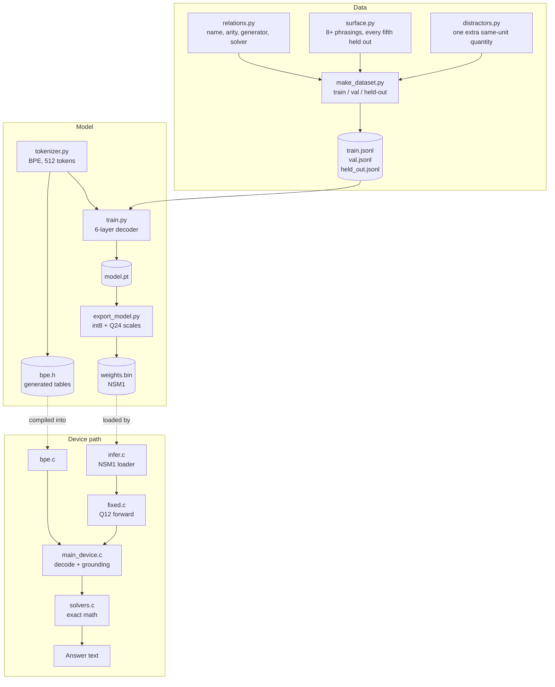
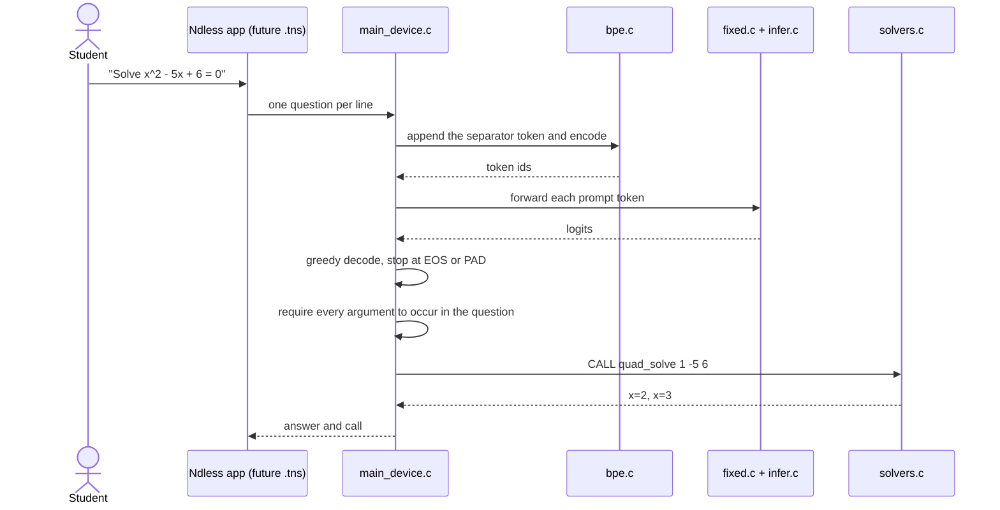

# Architecture

NdlessAI has two halves. An offline Python pipeline turns relation definitions into a dataset, a tokenizer, a trained checkpoint, and quantized weights. An on-device C11 runtime turns a question into a call, executes that call with exact arithmetic, and formats the answer. Ndless supplies the calculator platform around the runtime.

## Design constraints

- **No FPU on the target.** A CX II uses an ARM926EJ-S without floating-point hardware. A stray float in the decode loop costs thousands of cycles, so the hot path is integer-only and the cross-compile check fails on soft-float helpers.
- **Every token rereads the weights.** Sequential RAM reads measured about 70.5 MB/s, and the largest single allocation is about 21.56 MiB. Token count, not kernel cleverness, is the main speed lever.
- **Answers must be exact.** The model selects a relation and fills numeric slots. `solvers.c` does the mathematics in integers and rationals, so the model never decides a final value.
- **Wrong answers are worse than no answer.** Every call argument must appear in the question, and malformed or ungrounded calls are refused.
- **The clock is disputed.** Reported values range from 144 MHz to 396 MHz. The `int8bench` sample measures the actual unit before a model size is fixed.

## Data and artifact flow



## Boundaries

| Component | Responsibility |
| --- | --- |
| `relations.py` | The contract. A relation owns its name, subject, parameter names, generator, solver, and whether it is exact. Fixed arity keeps the output grammar trivial. |
| `surface.py` | Multiple wordings per relation so the model learns the numbers, not one sentence. Indices are split deterministically: every fifth phrasing is held out. |
| `distractors.py` | Adds one plausible same-unit quantity to a question without changing the correct call. Applied to about half the rows. |
| `make_dataset.py` | Builds train, validation, and held-out-wording splits, and trains the tokenizer on a sample. Split seeds are disjoint. |
| `tokenizer.py` | Byte-level BPE with 512 tokens. `CALL`, `<sep>`, `<eos>`, `<pad>`, `<bos>`, and each relation name are single reserved tokens above id 255. |
| `train.py` | Llama-2-style decoder with RoPE, RMSNorm, SwiGLU, and tied embeddings. The loss is masked to call tokens, and a training window never straddles two rows. |
| `export_model.py` / `export_int8.py` | Per-output-channel int8 quantization with group size 32 and Q24 fixed-point scales. Emits `NSM1` weights and a reference logit fixture. |
| `export_tokenizer.py` | Regenerates the BPE tables inside `runtime/bpe.h` from the exact tokenizer the checkpoint was trained with. |
| `runtime/infer.c` | Loads and validates `NSM1`, and provides a float reference forward pass used for parity checks. |
| `runtime/fixed.c` | The device forward pass: int8 dot products, Q12 activations, table-based exp and reciprocal, integer softmax, and Q14 RoPE. |
| `runtime/bpe.c` | Byte-level BPE encode and decode with the embedded tables. |
| `runtime/solvers.c` | Exact rational solvers for all eleven relations, plus decimal formatting for non-exact subjects. |
| `runtime/main_device.c` | The end-to-end device path: prompt suffix, BPE encode, greedy decode, grounding check, solver dispatch, and answer formatting. |
| `runtime/main_host.c` | Host-only generation entry point used by the Python evaluators and parity tests. |
| `ndless-sdk/samples/int8bench/` | Measures int8 dot-product cost and the real clock on the calculator. It is not part of the solver. |

## The call contract

A call is one line with a fixed number of whitespace-separated fields:

```text
CALL <relation> <arg> <arg> ...
```

Examples:

```text
CALL quad_solve 1 -5 6
CALL integr_poly3 1 -3 2 0 4
CALL gas_p 0.5 298 1
```

The runtime enforces the contract in three places:

1. `main_device.c` decodes at most 20 tokens and stops at `<eos>` or `<pad>`.
2. `args_are_grounded` requires every argument string, from the third field onward, to occur in the original question. This catches the model's dominant failure: copying a plausible digit that belongs to a distractor.
3. `solvers_solve` rejects an unknown relation, a wrong argument count, a malformed number, complex roots, or a singular system.

The solver is the only component that produces an answer. The model produces a call, and a call that fails validation produces no answer.

## A question on the device path



`main_device.c` is a host-runnable program today. It is compiled for `arm926ej-s` in CI-style checks with `runtime/crosscheck.sh`, but no Ndless `.tns` wrapper or on-calculator UI exists yet.

## Quantization and fixed point

The export format is deliberately small and loadable without a framework:

```text
NSM1
dim, layers, heads, hidden, vocab            five int32 values
tok_emb                                      int8 matrix + int32 scales
wq, wk, wv, wo, w1, w3, w2                   stacked per layer, int8 + scales
n1, n2, norm                                 float parameters
```

Every quantized matrix uses groups of 32 columns. Each group has one Q24 scale, which kept the maximum per-group reconstruction error at `4.2e-4` in the recorded export. Q16 was rejected because its weight error was too large.

| Value | Format |
| --- | --- |
| Activations, logits, attention scores | `int16` or `int32`, Q12 |
| Softmax weights | Q15, summing to about 32768 |
| RoPE cosine and sine | Q14 |
| RMSNorm gains | Q12 |
| Weight group scales | Q24 as stored, converted at init |

`qstate_init` may use libm because it builds the exp, SiLU, rsqrt, reciprocal, and RoPE tables. After that, `forward_q` uses integer arithmetic only. `crosscheck.sh` compiles the runtime for ARM and inspects the object files for `__aeabi_f*` or `__aeabi_d*` references, excluding initialization and solver code.

## Failure behavior

| Condition | Output |
| --- | --- |
| Question longer than the line buffer | `!input_too_long` |
| BPE encode fails, or the prompt fills the sequence | `!encode_failed` |
| Forward pass fails | `!forward_failed` |
| Call cannot be parsed, uses an unknown relation, or has the wrong arity | `bad` line with the call, no answer |
| A call argument does not occur in the question | `!uncertain` line with the call, no answer |
| Complex roots, singular system, or arithmetic overflow | `bad` line, no answer |
| `<eos>` or `<pad>` sampled | Generation stops normally |
| Fixed-point saturation | Counted in `fixed_sat_count`; print it with `NSM_IDS=1` |

## Verification

| Check | What it establishes |
| --- | --- |
| `make test` | Golden answers for every relation, exact formatting, call round-trips, surface coverage, no held-out wording leaks into training, distractor safety, quantization error bound, tokenizer round-trips, window packing, loss decrease, C/PyTorch logit parity, and tokenizer-header synchronization |
| `runtime/test_solvers` | Solver outputs, decimal formatting, and rejection codes |
| `runtime/test_bpe` | BPE cases against the committed fixture |
| `runtime/test_fixed` | Fixed-point logits against the float reference, on real and synthetic inputs |
| `runtime/crosscheck.sh` | Compiles for `arm926ej-s` and rejects soft-float in the hot loop; exits 77 when the cross compiler is absent |

Recorded results from `stem-model/PLAN.md`:

- The C int8 engine matched PyTorch logits to `7.4e-07` with identical argmax.
- The int8 engine produced `95.0%` exact calls on 60 validation problems and never selected the wrong relation.
- The full device path produced `93.8%` exact calls on 80 validation problems, `0%` wrong relations, and `95.0%` correct final answers.

These are early measurements, not acceptance-gate results. The plan's gates separate problems with and without distractors and require a decline rate as well as accuracy.

## What is not built yet

- A `.tns` application that loads `weights.bin` from the calculator filesystem and presents a question-and-answer UI.
- Static device buffers for `qwork_t`; `qwork_alloc` is a host convenience, and a device port must supply fixed-size storage.
- A full-model benchmark on physical hardware. `int8bench` measures the kernel cost, and the runtime has been cross-compiled, but the complete pipeline has not been timed on a calculator.
- Power, thermal, and long-session behavior.
- Relations beyond the eleven listed in the README.
